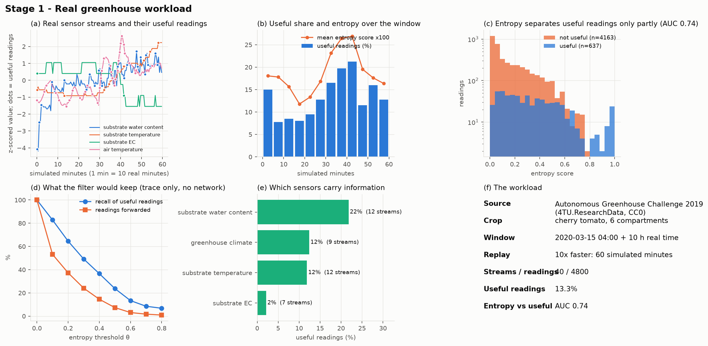
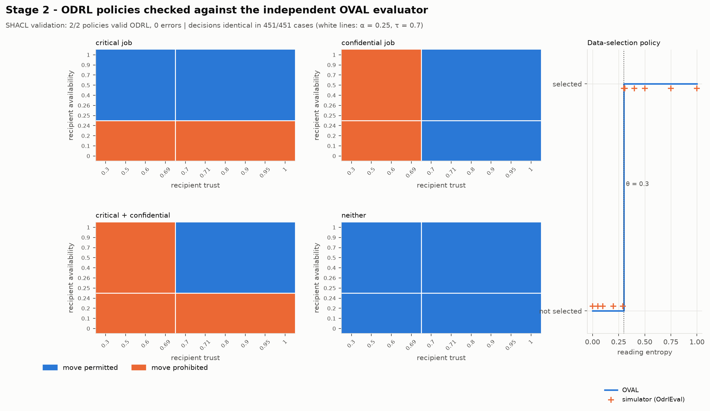
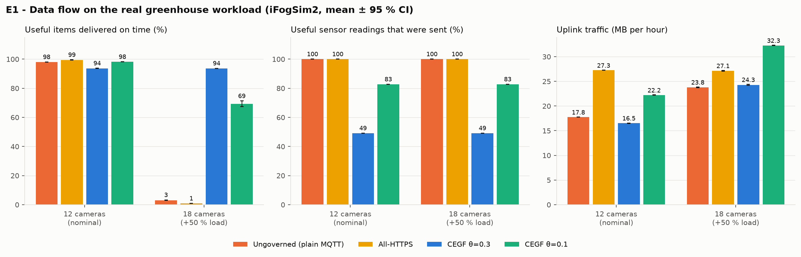
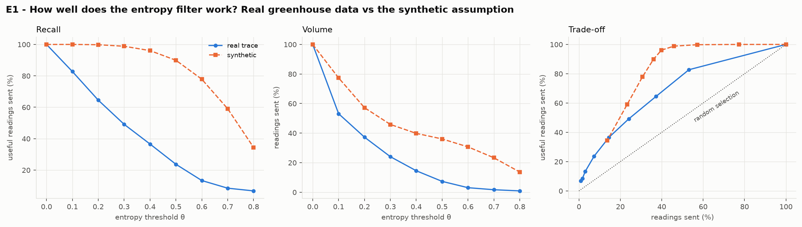
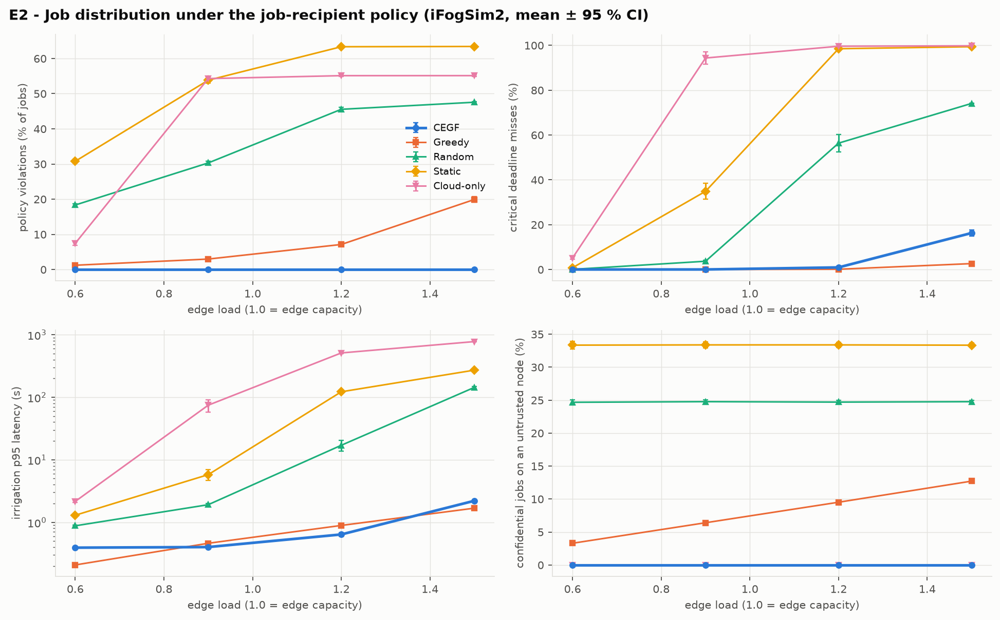
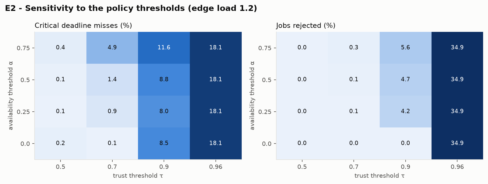
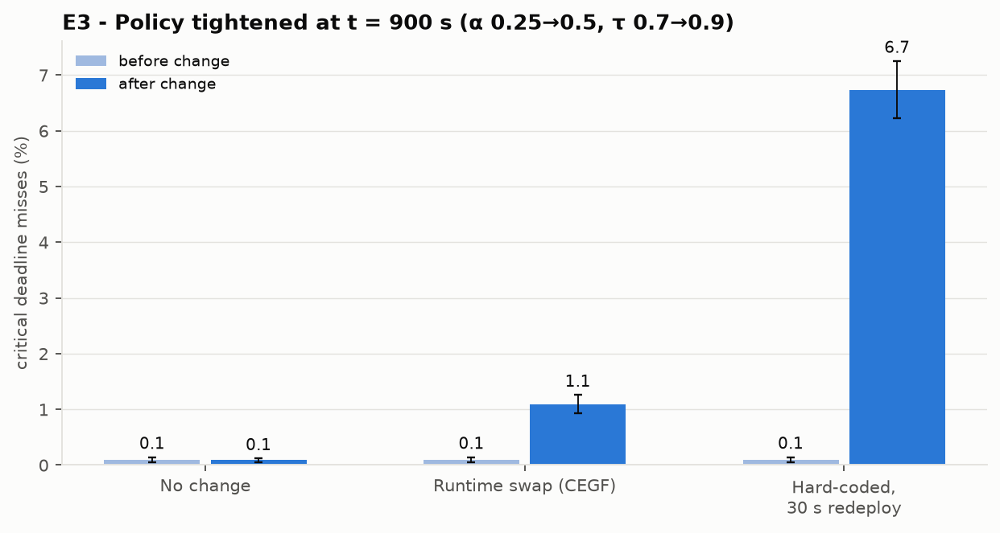

# Run summary

Generated 2026-11-23 12:30 | git 6da368f | openjdk version "21.0.13.1" 2026-11-17 LTS | Python 3.12.10 | 20 seeds per configuration | iFogSim2 only (the Python simulator was not used).

## Stage 1 - Real workload

Autonomous Greenhouse Challenge 2019 (cherry tomato, 4TU.ResearchData, CC0). Window 2020-03-15 04:00 + 10 h replayed 10x faster = 60 simulated minutes.

* 40 sensor streams, 4800 readings; 13.3% of readings are useful (dead-band label).
* The entropy score separates useful from other readings only partly: AUC 0.74, mean score 0.34 (useful) vs 0.16 (other).
* At θ = 0.3 the filter would keep 49% of the useful readings while forwarding 24% of all readings.

## Stage 2 - Policy validation (OVAL)

* SHACL validation of the two ODRL policies: job_recipient_policy.ttl: valid (0 errors, 0 warnings), entropy_policy.ttl: valid (0 errors, 0 warnings).
* The simulator's evaluator and OVAL give identical decisions on 451/451 test cases (thresholds α=0.25, τ=0.7, θ=0.3; boundary values included).

## Stage 3 - iFogSim2 experiments

### E1 Data flow (real trace readings, synthetic camera frames)

| cameras | setup | useful on time % | useful readings sent % | readings sent % | uplink MB/h | sensor energy J/h | useful readings lost % |
|---|---|---|---|---|---|---|---|
| 12 | Ungoverned | 98.0 | 100.0 | 100.0 | 17.8 | 0.019 | 2.0 |
| 12 | All-HTTPS | 99.5 | 100.0 | 100.0 | 27.3 | 1.375 | 0.0 |
| 12 | CEGF θ=0.3 | 93.7 | 49.1 | 24.0 | 16.5 | 0.006 | 0.0 |
| 12 | CEGF θ=0.1 | 98.2 | 82.7 | 53.1 | 22.2 | 0.013 | 0.0 |
| 18 | Ungoverned | 3.1 | 100.0 | 100.0 | 23.8 | 0.019 | 2.0 |
| 18 | All-HTTPS | 0.9 | 100.0 | 100.0 | 27.1 | 1.375 | 0.0 |
| 18 | CEGF θ=0.3 | 93.6 | 49.1 | 24.0 | 24.3 | 0.006 | 0.0 |
| 18 | CEGF θ=0.1 | 69.3 | 82.7 | 53.1 | 32.3 | 0.013 | 0.0 |

Entropy threshold on real vs synthetic data (useful readings sent / readings sent, %):

| workload | θ=0.1 | θ=0.2 | θ=0.3 | θ=0.4 | θ=0.5 |
|---|---|---|---|---|---|
| real trace | 83 / 53 | 65 / 37 | 49 / 24 | 37 / 15 | 24 / 7 |
| synthetic | 100 / 77 | 100 / 57 | 99 / 46 | 96 / 40 | 90 / 36 |

### E2 Job distribution

| edge load | strategy | critical misses % | policy violations % | confidential on untrusted % | fallback % | irrigation p95 s |
|---|---|---|---|---|---|---|
| 0.9 | cegf | 0.0 | 0.0 | 0.0 | 0.0 | 0.40 |
| 0.9 | greedy | 0.0 | 3.0 | 6.4 | 0.0 | 0.46 |
| 1.2 | cegf | 0.9 | 0.0 | 0.0 | 2.4 | 0.64 |
| 1.2 | greedy | 0.1 | 7.1 | 9.5 | 0.0 | 0.89 |
| 1.5 | cegf | 16.3 | 0.0 | 0.0 | 16.9 | 2.20 |
| 1.5 | greedy | 2.6 | 19.9 | 12.7 | 0.0 | 1.68 |

### E3 Policy change at run time

| setup | critical misses before % | after % | policy violations % |
|---|---|---|---|
| No change | 0.1 | 0.1 | 0.0 |
| Runtime swap (CEGF) | 0.1 | 1.1 | 0.0 |
| Hard-coded, 30 s redeploy | 0.1 | 6.7 | 0.0 |

## Notes and limitations

* Camera frames, job arrivals, trust and availability values, loss rates and the 30 s redeploy outage are assumptions, not measurements.
* The iFogSim2 port has one cloud node and no edge failures.
* Raw per-run results are in `03_simulation/raw/`; every figure is also saved as PDF.
